# MOCHI

**Build habits. Level up.**

MOCHI is a pocket habit game for iOS and Android. Complete three real-world goals a day (drink water, move, eat well), add up to three bonuses (a progress selfie, the daily challenge, your own goal), earn XP and coins, watch a pixel pet grow through five stages, and unlock gear. Movement can complete itself from Apple Health or Health Connect, and a home screen widget keeps the pet and today's count in view. Everything runs offline on the device: no account, no backend, no ads.

## The cast

Five original pets in a chunky Tamagotchi-style pixel look, each with its own habitat, idle motion and growth details:

| Pet | Character | Habitat | Signature motion |
| --- | --- | --- | --- |
| **Tofu** the cat | Curious. Playful. Independent. | Rooftops at dusk | Tail sway and an ear twitch |
| **Juno** the owl | Calm. Watchful. Sharp. | Twilight pines | Wing lifts |
| **Pebble** the axolotl | Easygoing. Patient. Resilient. | Pond with reeds and lily pads | Gill wiggle and tail sway |
| **Ori** the penguin | Bold. Steady. Determined. | Snow coast with ice floes | Flipper flaps |
| **Fern** the forest sprite | Gentle. Grounded. Growing. | Mushroom glade | Sprout sway |

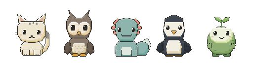

| Welcome | Choose a pet | Today | My pet |
| --- | --- | --- | --- |
| 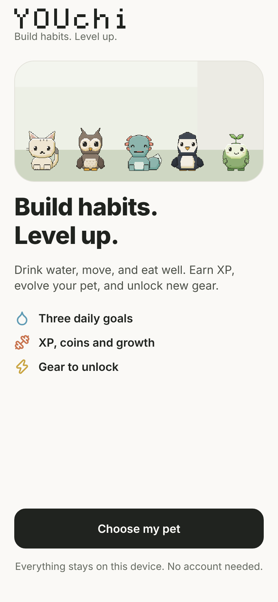 | 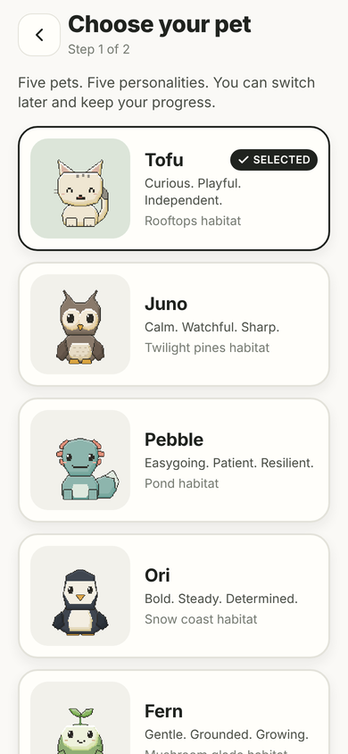 | 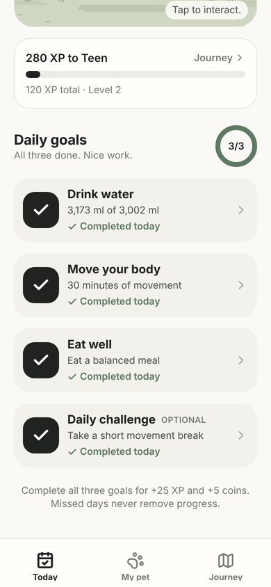 | 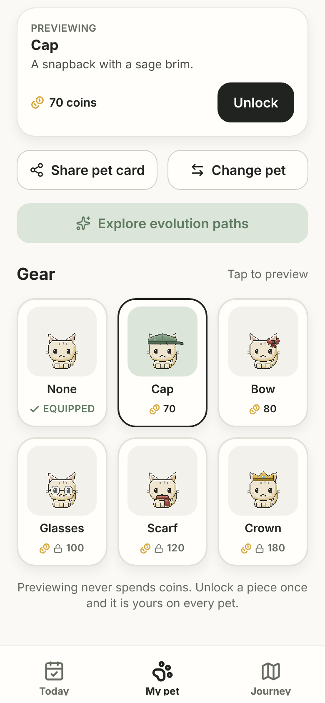 |

| Journey | Water | Evolution paths | Share card |
| --- | --- | --- | --- |
| 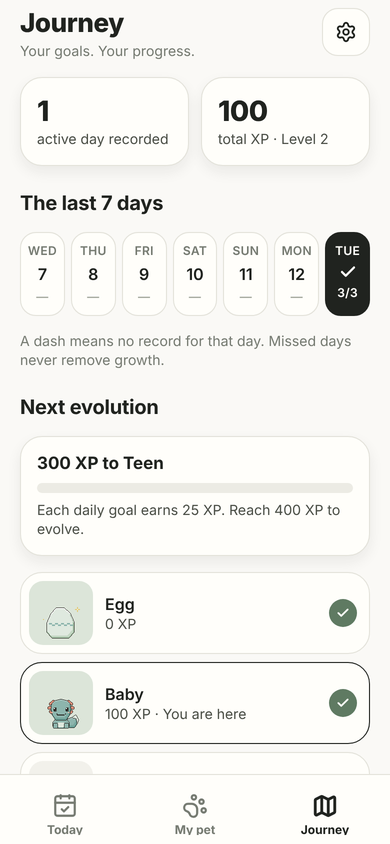 | 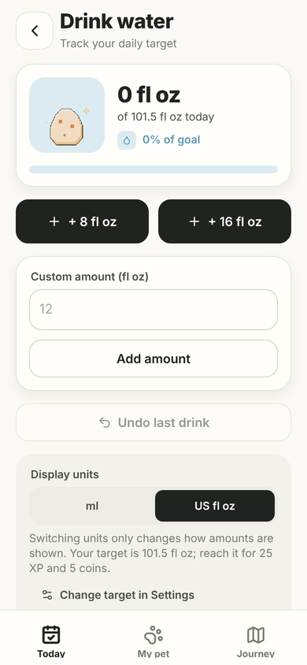 | 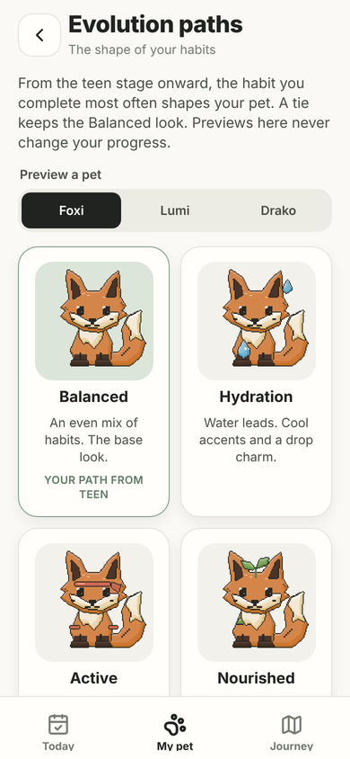 | 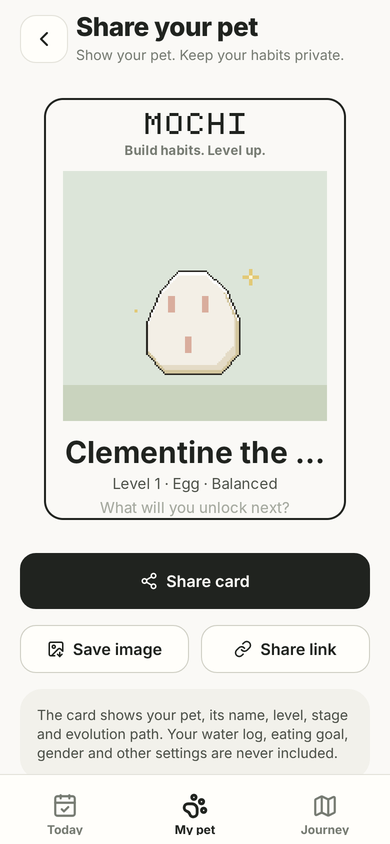 |

| Bonus tiles | Progress selfies | Custom goal | Health settings |
| --- | --- | --- | --- |
| 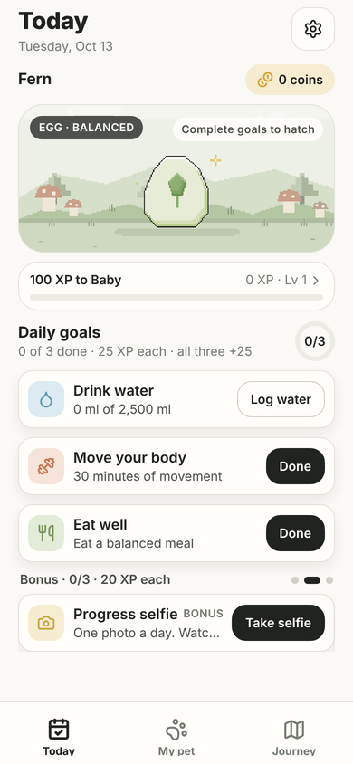 | 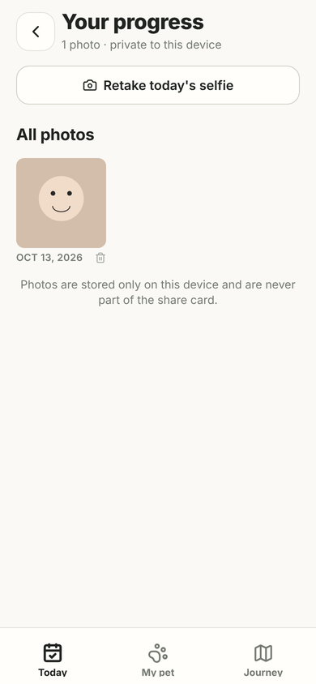 | 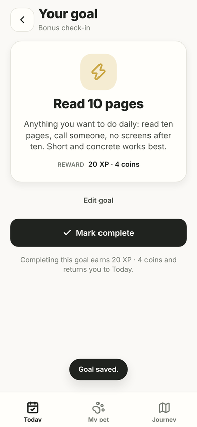 | 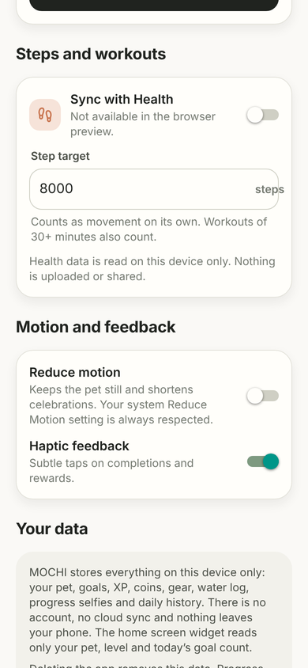 |

Pet moods, left to right: content, hungry, lazy, thirsty, asleep. The mood is the pet's way of pointing at the next goal, in the app and on the widget:

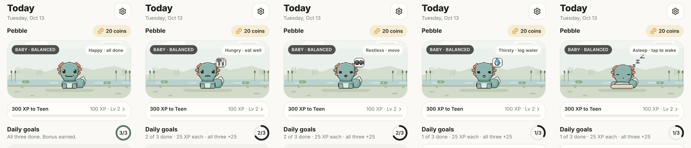

The whole cast at the teen stage, left to right: content, asleep, thirsty, hungry, lazy:

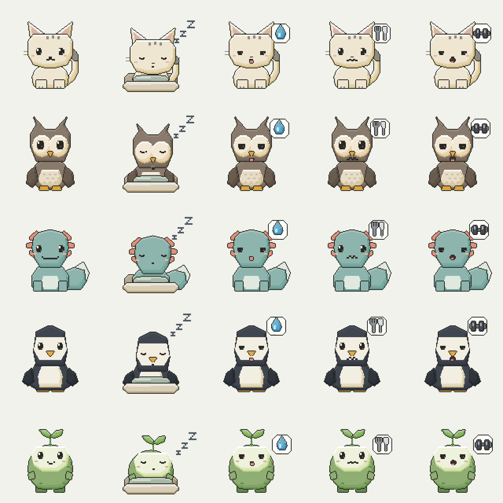

Gear and evolution paths on every pet (teen and adult rows):

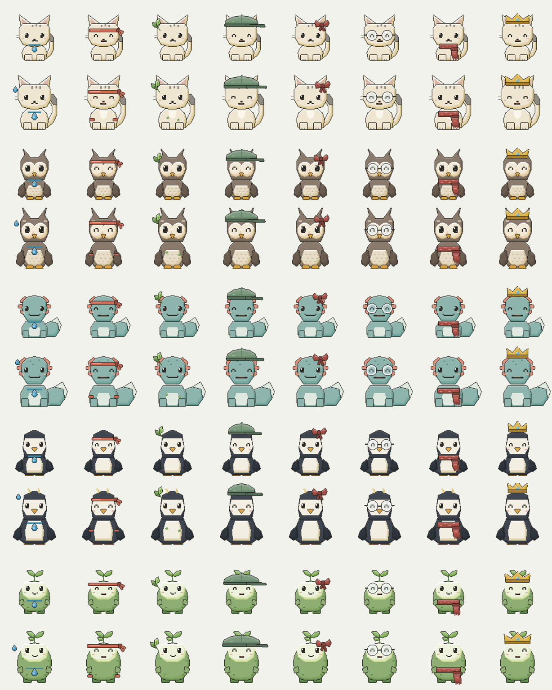

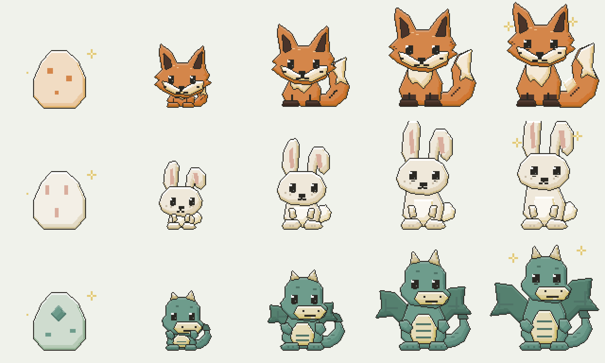

## Stack

- Expo SDK 57, React Native 0.86, TypeScript, Expo Router (native stack + bottom tabs).
- `@shopify/react-native-skia` renders the pixel art with nearest-neighbour sampling so edges stay crisp at any size, and renders the share card.
- `react-native-reanimated` drives sprite transforms, progress bars and rings on the UI thread.
- `@react-native-async-storage/async-storage` for durable local persistence (versioned schema, migrations, corrupt-data recovery).
- `expo-haptics`, `expo-sharing`, `expo-file-system`, `expo-media-library`, `expo-image-picker` for feedback, sharing and progress selfies.
- `react-native-health` (Apple Health) and `react-native-health-connect` (Android Health Connect) read steps and workouts.
- `expo-widgets` (iOS, WidgetKit) and `react-native-android-widget` (Android) for the home screen widget.
- `lucide-react-native` + `react-native-svg` for interface icons.

All game rules live in `src/game` as pure TypeScript with no React Native imports, so rewards, rollover, units, purchases and progression are unit-tested in isolation.

## Project layout

```
src/
  game/            pure game logic: types, constants, reducer, selectors, water units, persistence sanitiser, tests
  state/           GameProvider (hydration, persistence, date re-sync), CelebrationProvider (reward presentation)
  components/pet/  Skia sprite renderer, habitat stage, particles, gear grid
  components/      goal cards, bonus carousel, reward banner, share card, shared screens (profile form, pet choice, evolution paths, health settings)
  services/        health (Apple Health / Health Connect), selfies (private file storage), widget sync and the Skia pet renderer
  widgets/         iOS widget (expo-widgets, SwiftUI via @expo/ui) and Android widget (react-native-android-widget) plus its task handler
  ui/              design tokens and typed primitives (Text, Button, Card, Field, Segmented, Ring, Toast...)
  app/             Expo Router routes: onboarding/, (tabs)/today, (tabs)/pet, (tabs)/journey, settings (modal)
  assets/atlas.ts  generated sprite-sheet lookup
assets/
  sprites/         one sprite sheet per pet (bodies, eggs, path accents, gear overlays)
  scenes/          four habitat layers per pet (sky, far, near, ground)
  brand/, images/  logo, icons, splash, the cast line-up
  fonts/           Inter (OFL), subset to Latin, used only on the share card
tools/art/         Python pixel-art generator that builds every asset above
```

## Setup and run

Requirements: Node 22.13+, npm, and either Expo Go on a phone or a simulator/emulator.

```bash
npm install
npx expo start            # scan the QR code with Expo Go, or press i / a for a simulator
```

The core game runs in Expo Go. Three features need a development build because their native modules are not part of Expo Go: Apple Health / Health Connect sync, and the iOS and Android home screen widgets. In Expo Go those features degrade gracefully (health shows as unavailable in Settings, widget sync is skipped). For a development build or local native run:

```bash
npx expo run:ios          # requires Xcode on macOS
npx expo run:android      # requires Android Studio / SDK
```

Useful scripts:

```bash
npm test                  # Jest: game rules (51 tests)
npm run typecheck         # tsc --noEmit
npm run lint              # expo lint (ESLint + React Compiler rules)
npm run doctor            # expo-doctor
npm run art               # regenerate all pixel art (needs python3 with Pillow and numpy)
npm run web               # browser preview (copies CanvasKit to public/ first)
```

## Producing iOS and Android builds

The project is configured for EAS Build (`bundleIdentifier` / `package`: `com.mochi.habits`).

```bash
npm install -g eas-cli
eas login
eas build:configure                      # creates eas.json on first run

eas build --platform ios --profile preview        # internal/TestFlight-style build
eas build --platform android --profile preview    # APK for sideloading
eas build --platform all --profile production     # store builds
eas submit --platform ios                         # App Store Connect
eas submit --platform android                     # Google Play
```

Local builds without EAS: `npx expo prebuild` generates the `ios/` and `android/` projects, then open them in Xcode or Android Studio (or run `npx expo run:ios --configuration Release` / `npx expo run:android --variant release`).

Permissions declared in `app.json`: photo-library *add* access (share screen "Save image"), camera and photo-library *read* access (progress selfie), HealthKit read access on iOS and `READ_STEPS` / `READ_EXERCISE` for Health Connect on Android, and vibration for haptics. Each is requested only when the feature is first used.

## Bonuses, health and the widget

**Three bonus tiles** sit under the daily goals in a swipeable row (Today). Each earns 20 XP and 4 coins once per local day and never affects the evolution path:

1. **Progress photo**: take or pick one upper-body photo a day (3:4 portrait crop, head to waist, same spot each time). Photos are copied into the app's private documents directory; only the file name is stored in game state. The Progress screen shows a first-vs-latest comparison and a grid of all photos, each deletable. Selfies are never part of the share card.
2. **Daily challenge**: the rotating challenge, as before.
3. **Your goal**: a goal in your own words (set from the tile or in Settings). Clearing the text hides the tile's check-in; an earned reward stays.

**Health sync** (Settings → Steps and workouts): on iOS it reads steps and workouts from Apple Health via HealthKit; on Android from Health Connect. When enabled, the app reads today's totals on launch, on every return to the foreground and every five minutes, and the movement goal completes itself when workout minutes reach your movement target or steps reach your step target (default 8,000, editable). Completion comes with the usual reward and celebration, exactly once per day. A manual check-in is never downgraded, and nothing is written to the health platforms. Android builds set `minSdkVersion` 26 as Health Connect requires; a Play Store release additionally needs the Health Connect data-access declaration in the Play Console.

**Pet moods**: after hatching the pet always shows one of five states, chosen in priority order: asleep (no interaction for 36 hours; tapping wakes it), thirsty (water not logged), hungry (eating not checked in), lazy (movement not done), content (all three done). Each needy mood has its own expression and a status badge that reuses the goal icons (drop, fork and knife, dumbbell) so the cue is readable at widget size. A sleeping pet is actually in bed: it sinks into a cushion under a blanket with its eyes shut and its gear off, with bold Z's beside it. The Today stage shows the mood with a short caption, and the widget uses the same mood so a glance at the home screen says what to do next.

**Home screen widget**: iOS uses `expo-widgets` (a WidgetKit extension; the layout in `src/widgets/MochiWidget.tsx` is written with `@expo/ui` SwiftUI components and shipped inside the app). Android uses `react-native-android-widget` with a headless task handler registered in `src/boot.android.ts`. After any state change the app renders the current pet (with path accents and gear) to a PNG through an offscreen Skia surface, stores it in the shared app-group directory (iOS) or as a data URL alongside the snapshot (Android), and pushes a new snapshot. The small widget shows only the pet in its current mood. The medium widget adds a one-line nudge ("Tofu is thirsty. Log some water.") and three buttons, Water, Move and Eat, each marked Done or Log, that deep-link straight to the water log or the goal screen (`mochi://today/water`, `mochi://today/goal/movement`, `mochi://today/goal/eating`). The widget contains no amounts, photos or health data. Widgets need a development or store build.

## Launch features

- **Daily reminder** (Settings → Daily reminder): one local notification at a chosen time (presets or a custom 24-hour time). The body is re-scheduled after every change so it reflects today's remaining goals ("2 of 3 goals left today. Tofu is waiting."), or a neutral line for tomorrow once the time has passed. `expo-notifications`, local only, no push service.
- **Backup and restore** (Settings → Backup): exports a JSON file containing the full game state plus progress photos (base64) through the share sheet; restore picks a file, validates it through the same sanitiser used at startup, writes the photos back and replaces the state after an explicit confirmation. Restoring then rolls the day to today.
- **First-run coach mark** on Today, dismissed once; a **welcome-back card** after two or more days away that says progress was kept.
- **Store review prompt**: requested once, a few seconds after the first evolution past hatching (teen stage), through the native in-app review API.
- **Privacy**: an in-app Privacy screen (Settings → Privacy) and the full policy in `docs/PRIVACY.md`, ready to publish at a public URL for the store listings. `docs/STORE_LISTING.md` holds listing copy and the privacy declarations. `eas.json` has development, preview and production profiles.

## Game rules

- Each of the three daily goals: 25 XP + 5 coins. All three in one day: +25 XP + 5 coins. Each of the three bonus tiles (selfie, challenge, custom goal): 20 XP + 4 coins.
- Rewards are recorded in a per-day ledger keyed by the device's local calendar date, so taps, restarts, undo/redo and navigation can never award twice. Undo updates the day's record but never revokes rewards or lets them be re-earned.
- Stages: Egg 0, Baby 100, Teen 400, Adult 1,000, Companion 2,500 XP. After Companion the level keeps rising (`floor(XP / 100) + 1`). Missed days never remove anything.
- From the teen stage the pet's look follows the leading habit (Hydration, Active, Nourished) using per-goal reward counts; ties are Balanced. Counts cannot be inflated by undo.
- Water is stored in millilitres. 1 US fl oz = 29.5735295625 ml. Targets display rounded *up*, amounts rounded to nearest, and a target that looks reached counts as reached (0.5 ml tolerance).
- Gender only sets a starting water target (female 2,000 ml, male 3,000 ml, prefer-not-to-say 2,500 ml). It is an editable default, not medical advice, and affects nothing else.
- Gear: None free, Cap 70, Bow 80, Glasses 100, Scarf 120, Crown 180 coins. Purchases are atomic; coins never go negative; owned items cannot be bought twice. Previewing never spends coins.
- Day rollover happens on every action, on app foreground and once a minute; the outgoing day is written to history before daily tracking resets.

## Verification

Automated, run in this repository:

- `npm test`: 66 Jest tests over water units and rounding, exactly-once rewards, undo without farming, the all-three bonus, the three bonus tiles (selfie once per day, retakes, removal, custom goal validation and clearing, stacking), health activity (recording with sync off, workout and step thresholds, no downgrade of manual check-ins, settings changes, day reset), local-day rollover and resume, every stage threshold, final-stage levelling, path ties and leaders, counters under undo/redo, achievements on non-consecutive days, seven-day history with dashes, gear purchase / insufficient coins / double purchase / equip, persistence round-trip, corrupt and partial data recovery, migration chain, reset, backup restore, pet mood priority and the asleep timer, onboarding validation, pet switching and renaming.
- `npm run typecheck`, `npm run lint`, `npm run doctor`: all clean.
- `npx expo export --platform ios --platform android`: Hermes bundles build for both platforms.
- `npx expo prebuild` for both platforms: the generated Android manifest contains the widget receiver, Health Connect rationale activity and health permissions; the generated iOS project contains the `ExpoWidgetsTarget` extension with the `MochiWidget` Swift file, the app group and the HealthKit entitlement.
- Browser preview driven by Playwright at 390×844, 375×667 and 320×568: fresh install through onboarding for the pets, water quick-add and custom entry in ml and fl oz, undo, unit switching without drift, goal completion returning to Today with the reward banner, the egg hatch, undo from the detail screen, gear preview without spending, locked and insufficient states, the first purchase and equip, evolution previews for every pet, pet switching with preserved progress, share card generation, Journey history and achievements, settings validation and save, reduce-motion and haptic toggles, reset confirmation, and persistence across a page reload.

Not run (no simulator or device available in the build environment):

- iOS and Android device/simulator runs, including real haptics, the native share sheet, saving to Photos, the camera, Dynamic Type at the largest settings, and system Reduce Motion. The code paths exist and type-check, but they were only exercised on the web preview where they are stubbed or unavailable.
- Local notifications, the document picker for restore, and the store review prompt (all stubbed on the web preview).
- Apple Health and Health Connect reads, and both home screen widgets. These need a development build on a real device (HealthKit does not run in the simulator at all). The native configuration was verified through prebuild only; the read queries, the WidgetKit snapshot updates and the Android headless render have not been executed.

## Limitations

- Sound effects are not implemented; the settings preference exists in the data model but there is no audio. Haptics and reduce-motion are implemented.
- Health sync and widgets are untested on devices (see Verification). `react-native-health` is a legacy bridge module that runs through the New Architecture interop layer; if a device build reports issues there, `@kingstinct/react-native-healthkit` is the drop-in alternative behind the same `src/services/health.ts` interface.
- The widget image omits animation and shows the happy frame; it refreshes when the app runs, plus the periodic system refresh (30 minutes on Android).
- Pixel art is generated programmatically (`tools/art`) rather than hand-painted. Stages differ in proportion, parts and details, and all five pets share one rendering style and 128×128 cells.
- The web preview is for development only. It needs `npm run web:setup` (copies CanvasKit), and saving to Photos is unavailable there.
- Progress from the MOCHI website does not transfer to the app; no import flow was built.
- There is no cloud sync. Deleting the app deletes progress unless a backup file was exported first.

## Licenses

Inter font: SIL Open Font License 1.1, see `assets/fonts/LICENSE-Inter-OFL.txt`. Icons: Lucide (ISC).
